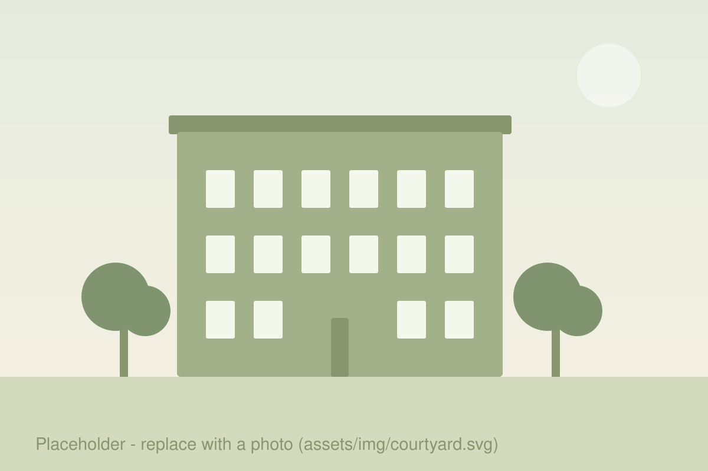

<!-- To use a real photo, save it as assets/img/courtyard.jpg (or .webp/.png)
     and change the src below. -->
<figure class="page-photo">
  
  <figcaption>The courtyard — placeholder photo.</figcaption>
</figure>

## What is a co-op?

<!-- TODO: A short paragraph about the building — when it was built, how the
     co-op is organised (owner-members, board, general meetings), and what
     makes living here different from renting. -->

## How we're organised

- **Board / house committee** — <!-- TODO: who serves, for how long, what they handle. --> Current members are listed on the [Contact page](contact.html).
- **General meetings** — <!-- TODO: how often they meet, how to get on the agenda, where minutes are published. -->
- **Resident association** — <!-- TODO: if applicable, how it differs from the board. -->

## House rules

The full rules are on the [Documents page](documents.html). The short version:

1. Be kind to your neighbours.
2. <!-- TODO: quiet hours. -->
3. <!-- TODO: what to do in an emergency (fire, flood, lockout). -->

## Costs & contributions

<!-- TODO: ownership share / monthly contribution, annual levy, who to ask about it. -->
