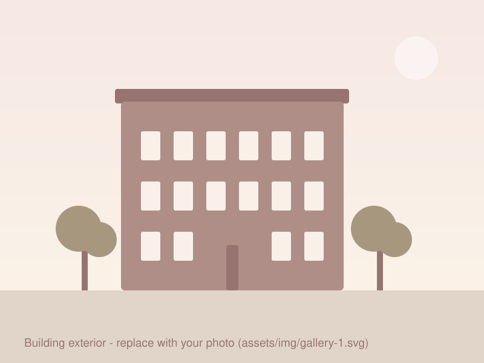
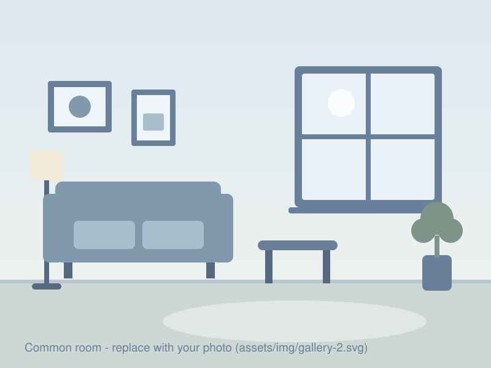
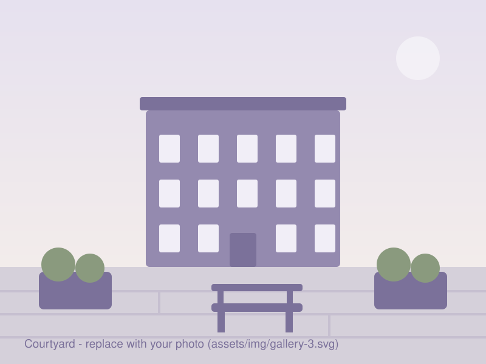
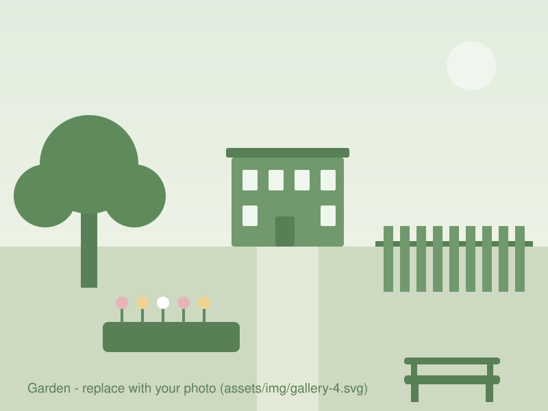
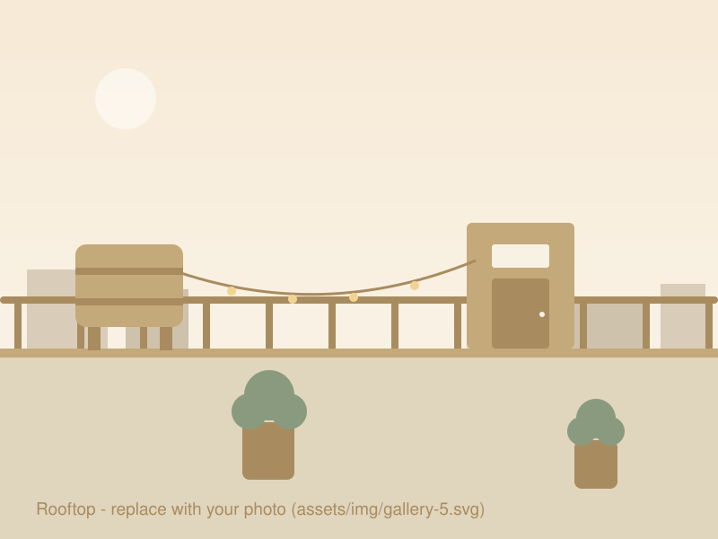
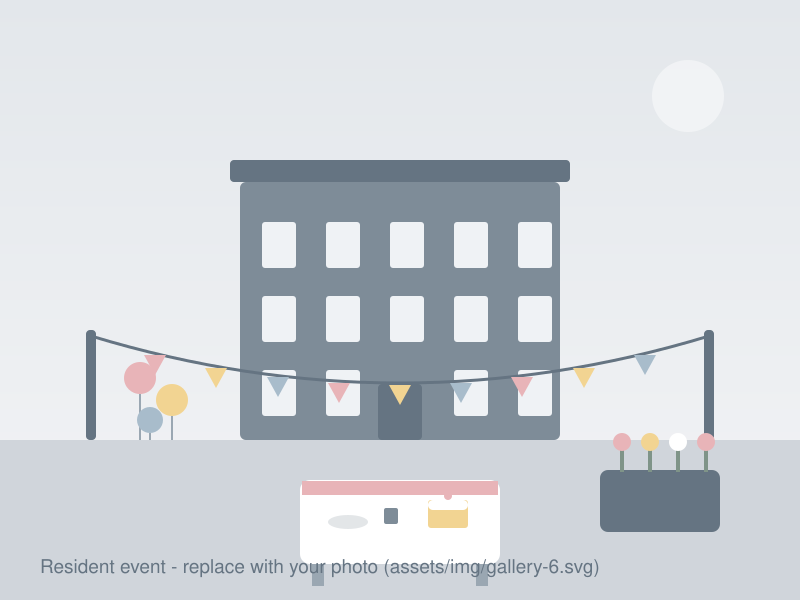

## Our building

<!-- To add a photo:
     1. Save the image in assets/img/ (e.g. courtyard-2026.jpg — .webp/.png also fine).
     2. Copy one of the <figure> blocks below, update the src and the alt text.
     Clicking a photo opens it full-size. -->

  <figure class="gallery-item">
    
    <figcaption>Placeholder 1 — building exterior</figcaption>
  </figure>
  <figure class="gallery-item">
    
    <figcaption>Placeholder 2 — common room</figcaption>
  </figure>
  <figure class="gallery-item">
    
    <figcaption>Placeholder 3 — courtyard</figcaption>
  </figure>
  <figure class="gallery-item">
    
    <figcaption>Placeholder 4 — garden</figcaption>
  </figure>
  <figure class="gallery-item">
    
    <figcaption>Placeholder 5 — rooftop</figcaption>
  </figure>
  <figure class="gallery-item">
    
    <figcaption>Placeholder 6 — resident event</figcaption>
  </figure>

## Share your photos

If you have a great photo of the building or a resident event, send it to
<!-- TODO: photo contact (name + email) --> and we'll add it — with credit
where appropriate.
