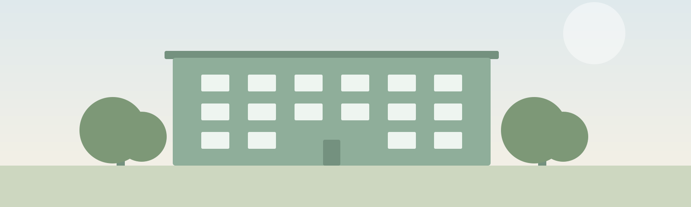

<!-- Hero photo: to use a real photo, save a wide image as assets/img/hero.jpg
     (or .webp/.png) and change the src below. -->
<figure class="hero">
  
  <figcaption>Placeholder — replace <code>assets/img/hero.svg</code> with a wide photo of the building.</figcaption>
</figure>

<h1>Hi, neighbours</h1>

The resident website for our cooperative building — announcements, events, and the documents that keep things running.

  <a class="card" href="about.html">
    
About the coop

    
How our building works

  </a>
  <a class="card" href="gallery.html">
    
Gallery

    
Photos of the building

  </a>
  <a class="card" href="events.html">
    
Events &amp; meetings

    
What's coming up

  </a>
  <a class="card" href="documents.html">
    
Documents

    
Rules, minutes &amp; downloads

  </a>
  <a class="card" href="contact.html">
    
Contact

    
Board &amp; neighbours

  </a>

<h2>Latest announcements</h2>
<ul class="post-list">

  <li>
    <a href="{{ post.url }}">{{ post.title }}</a>
    {{ post.date | date: "%b %d, %Y" }}
  </li>

</ul>
